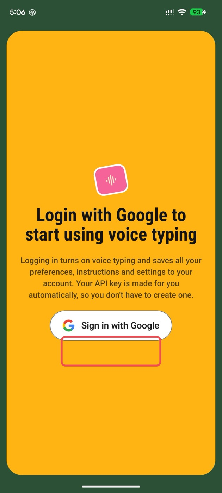
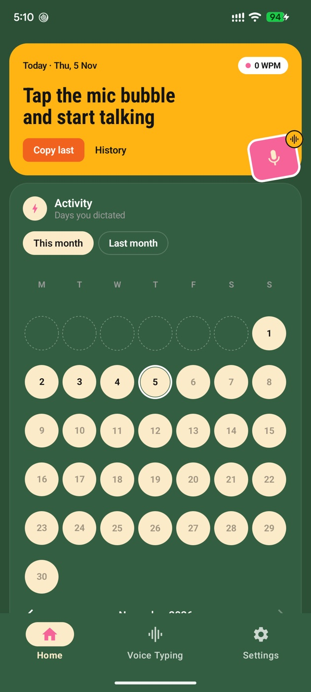
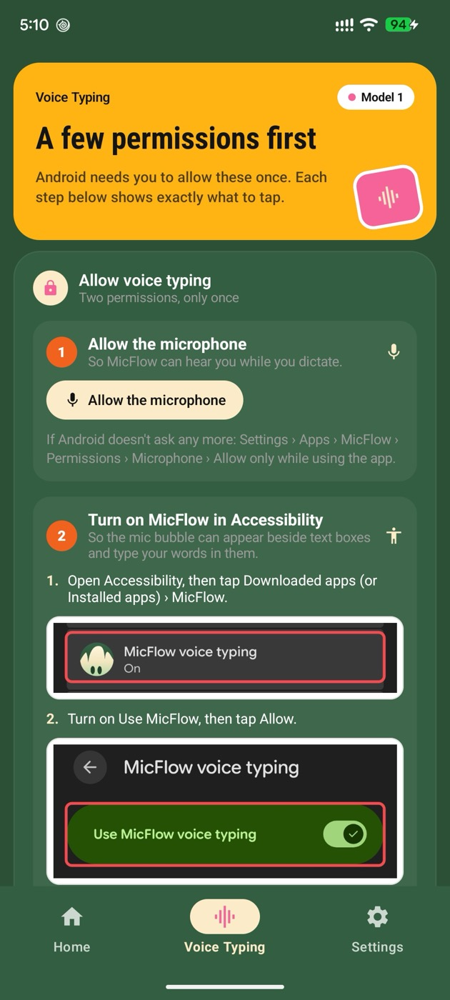

<h1 align="center">MicFlow for Android</h1>

<b>Talk instead of type, in any app on your phone.</b> 
Free. No word limit. English, Bengali, or both in one sentence.

  
  
  

## Why use it?

- **Faster than typing.** Tap the mic bubble beside any text box, speak, and it's written for you: WhatsApp, Gmail, Messenger, notes, anything.
- **Words appear as you speak**, then a moment later spelling, punctuation and filler words are cleaned up. Your own edits are never touched.
- **One account with the Mac app.** Sign in with Google: your free voice key is made for you, and your key, words, mix-ups and instructions come over from MicFlow on your Mac.
- **Home shows your numbers:** words today, speed, streak, languages and every dictation.
- **Two models:** Model 1 (best, live words, English and Bengali mixed) and Model 2 (needs no key; one language at a time).
- **Notifications** for new versions (one tap to update) and news.

## Universal Clipboard

Copy on your phone, paste on your Mac, and the other way round, with [MicFlow for Mac](https://github.com/abdulllahel/MicFlow). End-to-end encrypted; link your devices once in **Settings › General › Universal Clipboard**. If an app doesn't send when you tap Copy, use the **Send clipboard** tile in Quick Settings.

## Install

Read the **[install guide with pictures (PDF)](MicFlow-Install-Guide.pdf)**. In short:

1. Download `MicFlow-x.x.apk` from [Releases](../../releases/latest) in Chrome and tap **Download anyway**.
2. Open it and tap **Install**. If Play Protect says **App blocked**, pause *Scan apps with Play Protect* (Play Store › profile › Play Protect › ⚙), install, and it turns back on by itself.
3. Open MicFlow and **Sign in with Google**.
4. In **Voice Typing**, allow the microphone and turn on MicFlow in **Accessibility**. If Android says *Restricted setting*: App info › ⋮ › **Allow restricted settings**, then try again.

MicFlow for Mac: [abdulllahel/MicFlow](https://github.com/abdulllahel/MicFlow).
